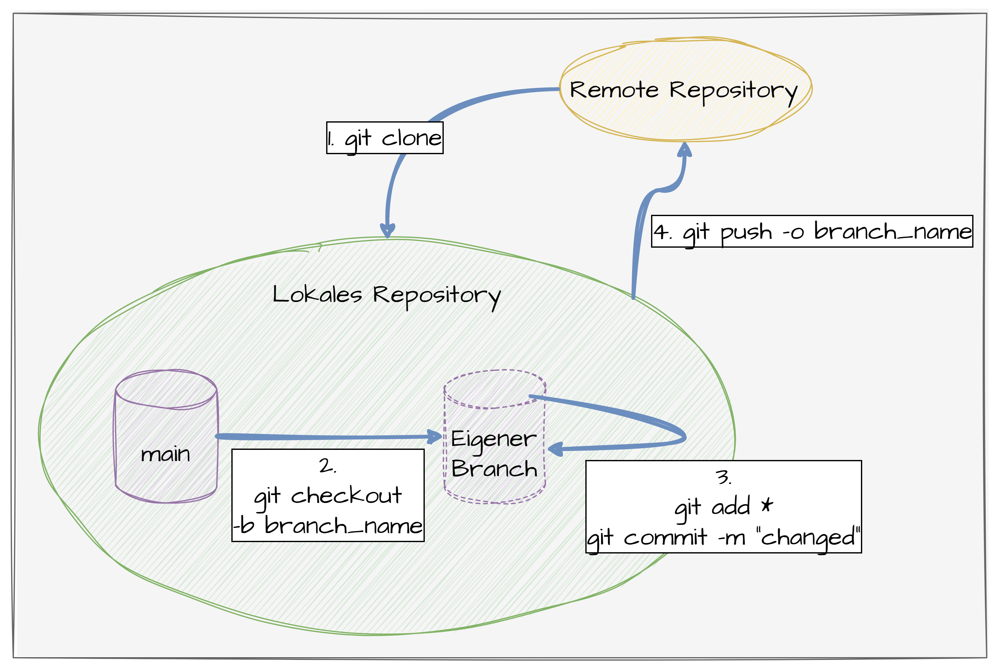

# Git in Kommandozeile Kurzübersicht



## 1. Repository von Remote kopieren:

```
git clone https://bszw-git.ddns.net:3000/swopperer/Zufallsgenerator.git
```

## 2. Neuen Branch erstellen und auschecken:

```
git checkout -b bfi11a_max_mustermann
```

## 3. Coden und Änderungen commiten:

```
git add *
git commit -m "Neue Klasse Person erstellt"
```

!!! info
    Commite lieber öfter als zu wenig!

## 4. Code in eigenen Branch pushen:

```
git push -u origin bfi11a_max_mustermann
```

!!! info
    `-u origin` ist nur beim **ersten** Push eines Branches nötig. Danach genügt `git push`.

## 5. Änderungen holen:

```
git pull
```

!!! info
    `git pull` holt die neuen Commits vom Server und baut sie in deinen aktuellen Branch ein. Lehnt Git einen Push mit `! [rejected] ... (fetch first)` ab, liegt auf dem Server ein Commit, den du noch nicht hast: `git pull`, danach wieder `git push`. Mehr dazu in [Zu zweit an einem Repository arbeiten](zu_zweit.md#wenn-der-push-abgelehnt-wird).

## 6. Branch zurückführen:

```
git switch main
git pull
git merge bfi11a_max_mustermann
git push
```

!!! info
    Git führt in den Branch zurück, in dem du gerade bist; `git switch main` wechselt dorthin. Fast-Forward, Merge-Commit und das Löschen des Branches erklärt [Zu zweit an einem Repository arbeiten](zu_zweit.md#mit-einem-branch-arbeiten-und-zuruckfuhren).
