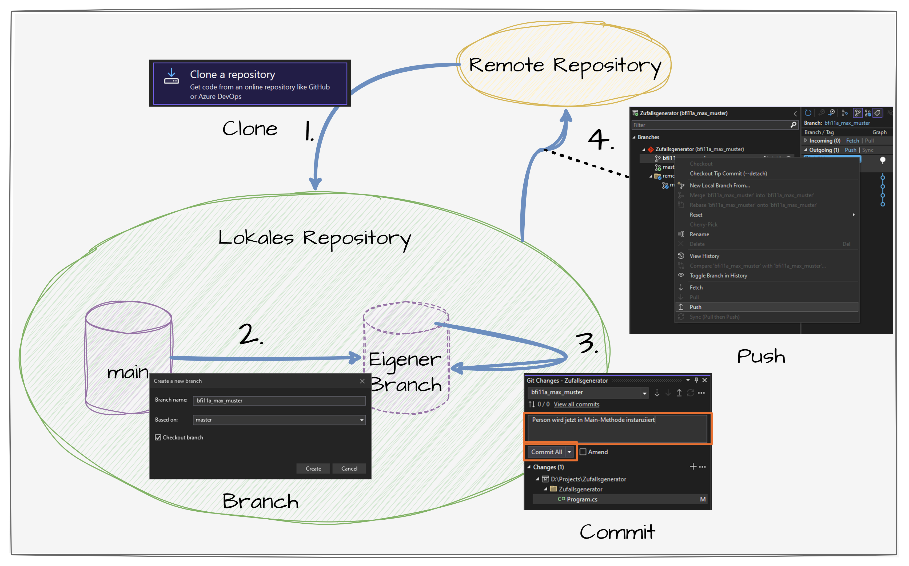
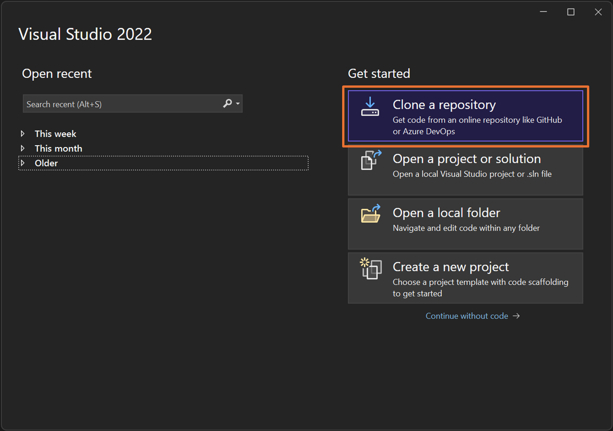
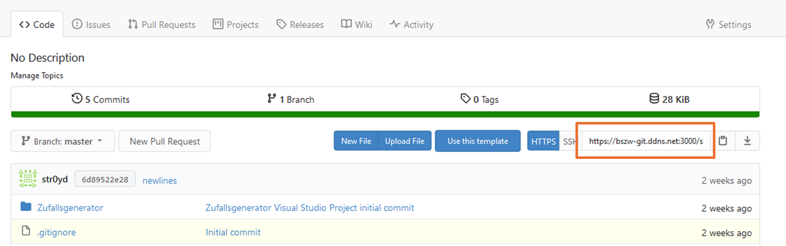
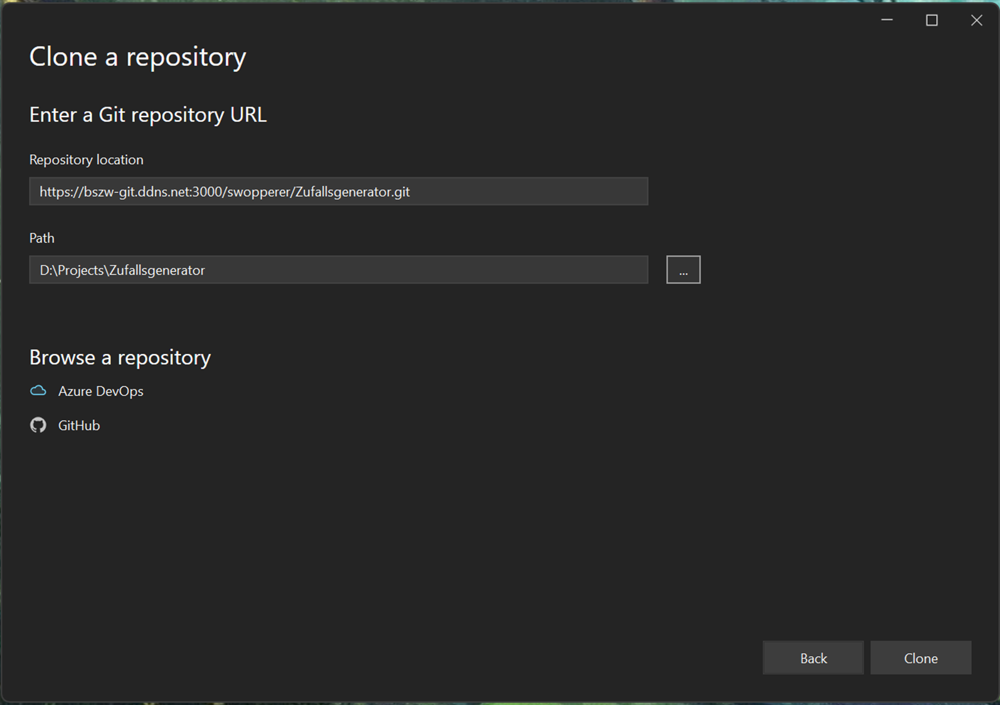
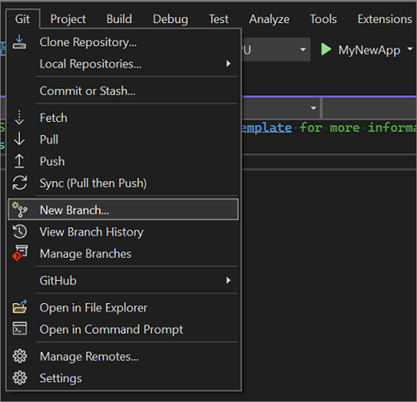
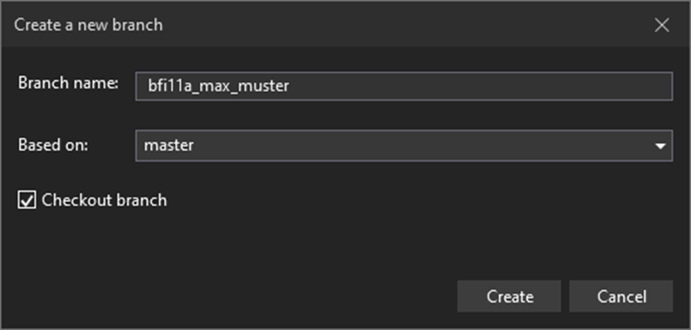
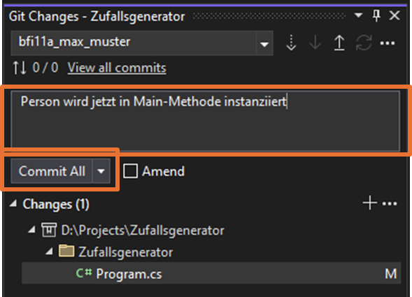
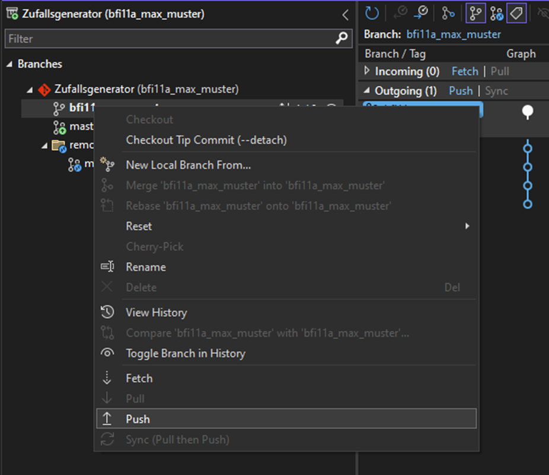

# Git in Visual Studio Kurzübersicht

## 1. Repository von Remote kopieren:

Visual Studio starten und "Clone a repository" wählen

{ width="600" }

URL des Remote Repos kopieren:

{ width="800" }

Danach Remote Repository URL und Pfad zum Speichern auf lokalem Gerät angeben:

{ width="600" }

## 2. Neuen Branch erstellen und auschecken:

Im Menübereich unter `Git` im Unterpunkt `New Branch...` kann ein neuer Branch angelegt werden:

{ width="500" }

Namen für den Branch vergeben (klasse_vorname_nachname) und von welchem Branch es weg kopiert werden soll:

{ width="500" }

## 3. Coden und Änderungen commiten:

Unter `Git Changes` Commit-Message eingegeben. Commit All fügt die angezeigten Änderungen automatisch zur Staging-Area hinzu und commitet im Anschluss automatisch mit der eingegebenen Commit-Message.

{ width="500" }

## 4. Code in eigenen Branch pushen:

Um die Änderungen jetzt im Remote Repository hochzuladen, muss der Branch mit den Änderungen noch gepusht werden:

{ width="500" }

## 5. Änderungen holen:

Im Fenster `Git Changes` auf die Schaltfläche `Pull` (zweite von links) klicken oder im Menü `Git` → `Pull` wählen. `Fetch` (ganz links) holt nur und zeigt unter dem Branchnamen an, wie viele Commits auf dem Server neu sind (*incoming*), ohne sie einzubauen.

!!! info
    Liegt dein Branch hinter dem auf dem Server, pusht Visual Studio nicht, sondern bietet `Pull then Push` an. Mehr dazu in [Zu zweit an einem Repository arbeiten](zu_zweit.md#dasselbe-in-visual-studio).

## 6. Branch zurückführen:

Im Menü `Git` → `Manage Branches`:

1. Rechtsklick auf `main` → `Checkout`, danach `Pull`.
2. Rechtsklick auf den eigenen Branch → `Merge 'bfi11a_max_mustermann' into 'main'`.
3. `Push`.
