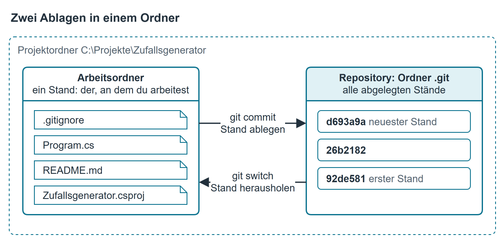
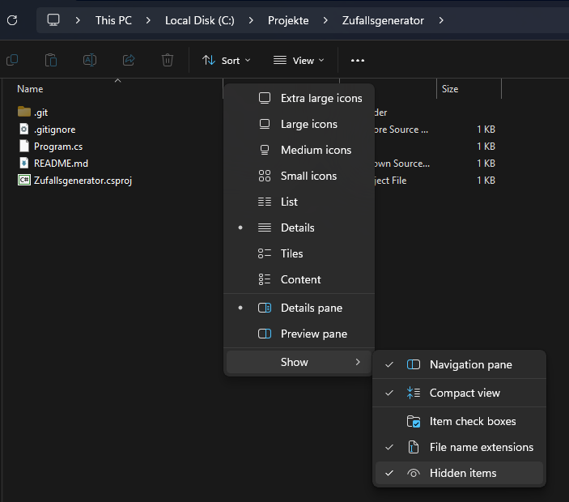
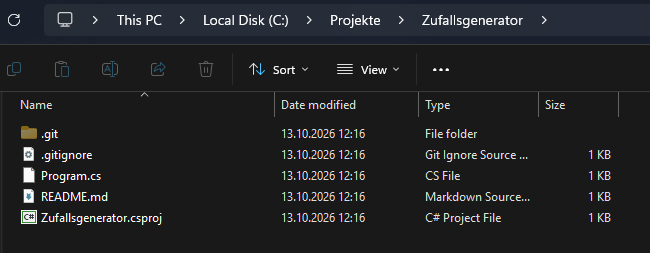
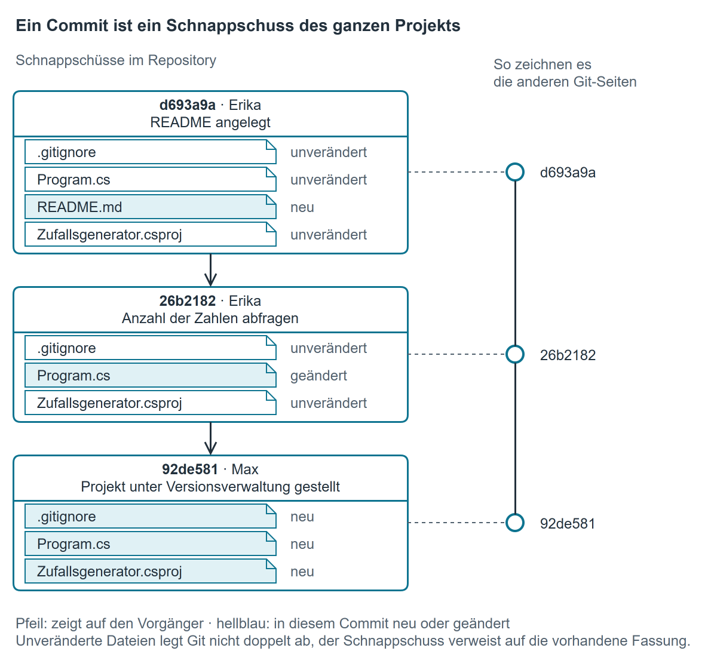
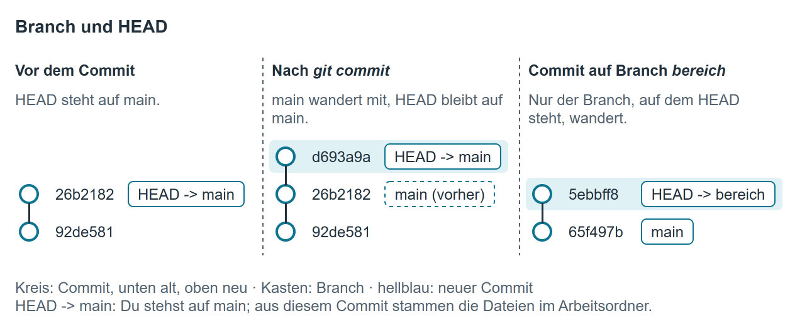

# Wie Git funktioniert

Diese Seite erklärt, was Git mit deinen Dateien macht. Welche Befehle du dafür eingibst, steht in den Kapiteln danach.

## Zwei Ablagen in einem Ordner

Ohne Git sichert man einen Stand, indem man den Projektordner kopiert: `Zufallsgenerator_alt`, `Zufallsgenerator_final`, `Zufallsgenerator_final2`. Git erledigt dasselbe geordnet und an einer Stelle. Neben deinen Dateien legt es eine zweite Ablage an, das **Repository**. Darin hebt Git jeden Stand auf, den du ihm übergibst.

{ .diagramm }

- Der **Arbeitsordner** ist der Projektordner, wie du ihn im Explorer und in Visual Studio siehst. Er enthält immer genau einen Stand: den, an dem du gerade arbeitest.
- Das **Repository** ist der Ordner `.git` im Projektordner. Er enthält alle Stände, die je abgelegt wurden.

Git ändert die Dateien im Arbeitsordner nie von selbst. Sie ändern sich nur, wenn du selbst etwas änderst oder einen Stand aus dem Repository herausholst.

!!! tip "Selbst nachsehen"
    Der Explorer blendet `.git` aus. Sichtbar wird der Ordner über `View` → `Show` → `Hidden items` (im deutschen Windows `Anzeigen` → `Einblenden` → `Ausgeblendete Elemente`):

    { .diagramm }

    Danach erscheint `.git` neben deinen Dateien:

    { .diagramm }

    Was in `.git` liegt, änderst du nie von Hand. Das erledigen die Git-Befehle.

Daraus folgt:

- Wer den Ordner `.git` löscht, löscht die ganze Historie. Die Dateien im Arbeitsordner bleiben, aber nur noch als ein einzelner Stand.
- Wer nur die Dateien weitergibt, etwa `Program.cs` per Mail, gibt einen Stand weiter, aber keine Historie.

## Ein Commit ist ein Schnappschuss

Einen Stand legst du mit einem **Commit** ab. Ein Commit ist ein Schnappschuss des ganzen Projekts, nicht nur der Datei, die du geändert hast. Zu jedem Commit merkt sich Git:

- eine **Kennung** wie `26b2182` (eigentlich 40 Zeichen lang; meist genügen die ersten sieben),
- wer ihn angelegt hat und wann,
- die **Nachricht**, die beim Commit angegeben wurde,
- seinen **Vorgänger**, also den Commit davor.

Über die Vorgänger hängen alle Commits zu einer Kette zusammen, der **Historie**.

{ .diagramm }

In den anderen Git-Kapiteln steht jeder Commit als Kreis, der neueste oben – so, wie `git log --graph` die Historie ausgibt (siehe [Ein Repository lesen](repository_lesen.md#historie-als-graph-uber-alle-branches)).

Ein Commit nimmt nicht von selbst jede Änderung mit. Mit `git add` legst du fest, was in den nächsten Commit kommt. Diese Auswahl heißt **Staging-Area**. Visual Studio erledigt beides in einem Schritt (`Commit All`).

## Einen Stand herausholen

Normalerweise steht im Arbeitsordner der neueste Stand, und du arbeitest daran weiter. Du kannst aber jeden abgelegten Stand zurück in den Arbeitsordner holen. Git tauscht dann die Dateien gegen die Fassungen aus diesem Commit aus, etwa um ein älteres Programm noch einmal zu bauen. Danach holst du den neuesten Stand wieder zurück. Wie das geht, steht unter [Einen älteren Stand ansehen](repository_lesen.md#einen-alteren-stand-ansehen).

Änderungen, die du noch nicht committet hast, stehen nur im Arbeitsordner. Würden sie beim Herausholen überschrieben, bricht Git ab und meldet es.

## Branch und HEAD

Ein **Branch** ist ein Name, der auf einen Commit zeigt, wie ein Zettel an einem Schnappschuss. Der Branch `main` zeigt auf den neuesten Commit deiner Hauptlinie. Legst du einen Commit an, wandert der Zettel des Branches, auf dem du gerade stehst, zum neuen Commit weiter.

**HEAD** zeigt, wo du gerade stehst, meist auf einem Branch. `git log` schreibt das als `HEAD -> main`. Aus dem Commit, auf den HEAD zeigt, stammen die Dateien in deinem Arbeitsordner.

{ .diagramm }

Einen Branch anzulegen kostet fast nichts: Git schreibt nur einen weiteren Zettel. Wie du mit einem Branch arbeitest und ihn zurückführst, steht unter [Mit einem Branch arbeiten und zurückführen](zu_zweit.md#mit-einem-branch-arbeiten-und-zuruckfuhren).

## Der Server: eine dritte Ablage

Auf dem Firmenserver (Gitea) liegt ein weiteres Repository, ohne Arbeitsordner. Git nennt es `origin`.

- `git clone` kopiert das Repository vom Server mit der ganzen Historie auf deinen Rechner und holt den neuesten Stand in einen neuen Arbeitsordner.
- `git push` und `git pull` gleichen danach Commits zwischen deinem Repository und dem auf dem Server ab.
- `origin/main` in deinem Repository ist der Stand von `main` auf dem Server, wie dein Rechner ihn zuletzt gesehen hat.

{ .diagramm }

Ein Commit allein bleibt auf deinem Rechner, erst `git push` bringt ihn auf den Server. Daraus folgt: Löschst du deinen Projektordner, bleibt auf dem Server alles, was du gepusht hast. Was du nur committet, aber nicht gepusht hast, ist mit dem Ordner weg.

## Begriffe auf einen Blick

| Begriff | Bedeutung |
|---|---|
| Arbeitsordner | Projektordner mit dem Stand, an dem du gerade arbeitest |
| Repository | Ablage aller Stände: auf deinem Rechner der Ordner `.git`, außerdem auf dem Server |
| Commit | abgelegter Schnappschuss des ganzen Projekts mit Kennung, Autor, Datum, Nachricht und Vorgänger |
| Historie | Kette der Commits über ihre Vorgänger |
| Staging-Area | Auswahl der Änderungen für den nächsten Commit (`git add`) |
| Branch | Name, der auf einen Commit zeigt und bei jedem neuen Commit mitwandert |
| HEAD | die Stelle, an der du gerade stehst, meist ein Branch |
| `origin` | das Repository auf dem Server; `origin/main` ist dessen `main`, wie dein Rechner ihn zuletzt gesehen hat |

## Wie es weitergeht

- Ein Projekt zum ersten Mal unter Git stellen: [Bestehendes Projekt unter Git stellen](bestehendes_projekt.md)
- Das Repository auf einen zweiten Rechner holen und gemeinsam daran arbeiten: [Zu zweit an einem Repository arbeiten](zu_zweit.md)
- Die Historie lesen und ältere Stände ansehen: [Ein Repository lesen](repository_lesen.md)
