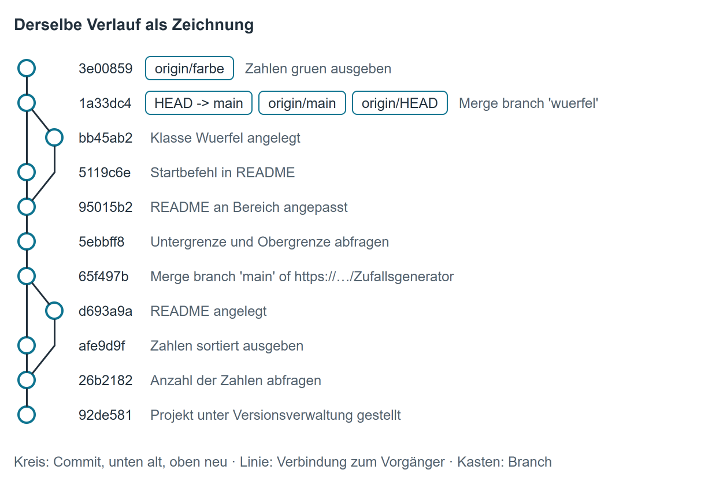

# Ein Repository lesen

Wer ein Repository übernimmt oder sich ein fremdes ansieht, will meist dreierlei wissen: Wer hat wann was geändert? Welche Branches gibt es, und sind sie zurückgeführt? Welche Dateien liegen überhaupt darin? Die Befehle auf dieser Seite lesen nur. Sie ändern nichts an der Historie und nichts auf dem Server; einzig [Einen älteren Stand ansehen](#einen-alteren-stand-ansehen) stellt vorübergehend die Dateien in deinem Projektordner um.

Voraussetzung: Das Repository ist geklont (siehe [Zu zweit an einem Repository arbeiten, Schritt 1](zu_zweit.md#schritt-1-repository-auf-einen-zweiten-rechner-holen)), und du gibst die Befehle im Projektordner ein. Wer nur schauen will, ohne zu klonen, findet dasselbe [auf dem Firmenserver](#dasselbe-auf-dem-firmenserver-gitea).

Als Beispiel dient das Repository `Zufallsgenerator` aus dem Kapitel [Zu zweit an einem Repository arbeiten](zu_zweit.md).

!!! info "Stand des Servers"
    Git zeigt die Branches des Servers so, wie sie beim letzten Holen waren. Was andere seitdem gepusht haben, erscheint erst nach `git fetch`. `git fetch` ändert nichts an deinen Dateien.

!!! info "Lange Ausgaben"
    Passt eine Ausgabe nicht ins Fenster, zeigt Git sie seitenweise an. Mit der ++space++-Taste blätterst du weiter, mit ++q++ kommst du zurück zur Eingabe.

## Historie als Liste

```
git log --oneline
```

```
1a33dc4 (HEAD -> main, origin/main, origin/HEAD) Merge branch 'wuerfel'
5119c6e Startbefehl in README
bb45ab2 Klasse Wuerfel angelegt
95015b2 README an Bereich angepasst
5ebbff8 Untergrenze und Obergrenze abfragen
65f497b Merge branch 'main' of https://bszw-git.ddns.net:3000/swopperer/Zufallsgenerator
afe9d9f Zahlen sortiert ausgeben
d693a9a README angelegt
26b2182 Anzahl der Zahlen abfragen
92de581 Projekt unter Versionsverwaltung gestellt
```

Jede Zeile ist ein Commit, der neueste steht oben. Vorn steht die **Kennung**: Git berechnet für jeden Commit eine eindeutige, 40 Zeichen lange Prüfsumme (den *Hash*) und zeigt hier die ersten sieben Zeichen davon. Mit der Kennung sprichst du einen Commit in anderen Befehlen an. Danach folgt die erste Zeile der Commit-Nachricht.

In Klammern steht, welche Branches gerade auf diesen Commit zeigen: `HEAD -> main` ist der Branch, in dem du gerade bist, `origin/main` der Stand von `main` auf dem Server, `origin/HEAD` der Standardbranch des Servers.

`git log --oneline -5` zeigt nur die letzten fünf Commits.

## Historie mit Name und Datum

```
git log --pretty=format:"%h %an %ad %s" --date=short
```

```
1a33dc4 Max Mustermann 2026-10-10 Merge branch 'wuerfel'
5119c6e Erika Musterfrau 2026-10-09 Startbefehl in README
bb45ab2 Max Mustermann 2026-10-09 Klasse Wuerfel angelegt
95015b2 Erika Musterfrau 2026-10-08 README an Bereich angepasst
5ebbff8 Erika Musterfrau 2026-10-08 Untergrenze und Obergrenze abfragen
65f497b Max Mustermann 2026-10-07 Merge branch 'main' of https://bszw-git.ddns.net:3000/swopperer/Zufallsgenerator
afe9d9f Max Mustermann 2026-10-07 Zahlen sortiert ausgeben
d693a9a Erika Musterfrau 2026-10-07 README angelegt
26b2182 Erika Musterfrau 2026-10-06 Anzahl der Zahlen abfragen
92de581 Max Mustermann 2026-10-05 Projekt unter Versionsverwaltung gestellt
```

| Platzhalter | steht für |
|---|---|
| `%h` | Kennung |
| `%an` | Name der Person, die den Commit angelegt hat (aus ihrem `user.name`) |
| `%ad` | Datum des Commits; `--date=short` schreibt es als Jahr-Monat-Tag |
| `%s` | erste Zeile der Commit-Nachricht |

Nur die Commits einer Person zeigt `git log --oneline --author="Erika"`.

Alles ausführlich, mit E-Mail-Adresse und Uhrzeit, zeigt `git log` ohne Zusatz. Der erste Eintrag sieht so aus:

```
commit 1a33dc4e7e26740e7a7872ede8c0506bba244655 (HEAD -> main, origin/main, origin/HEAD)
Merge: 5119c6e bb45ab2
Author: Max Mustermann <max.mustermann@bszw.de>
Date:   Sat Oct 10 10:00:00 2026 +0200

    Merge branch 'wuerfel'
```

Die Zeile `Merge:` gibt es nur bei einem Merge-Commit; sie nennt seine beiden Vorgänger.

## Historie als Graph über alle Branches

```
git log --oneline --graph --all
```

```
* 3e00859 (origin/farbe) Zahlen gruen ausgeben
*   1a33dc4 (HEAD -> main, origin/main, origin/HEAD) Merge branch 'wuerfel'
|\
| * bb45ab2 Klasse Wuerfel angelegt
* | 5119c6e Startbefehl in README
|/
* 95015b2 README an Bereich angepasst
* 5ebbff8 Untergrenze und Obergrenze abfragen
*   65f497b Merge branch 'main' of https://bszw-git.ddns.net:3000/swopperer/Zufallsgenerator
|\
| * d693a9a README angelegt
* | afe9d9f Zahlen sortiert ausgeben
|/
* 26b2182 Anzahl der Zahlen abfragen
* 92de581 Projekt unter Versionsverwaltung gestellt
```

{ .diagramm }

So liest du den Graphen, von unten nach oben:

- Jeder `*` ist ein Commit, die Linien verbinden ihn mit seinem Vorgänger.
- Bei `|/` teilt sich die Historie in zwei Linien: Ab hier haben zwei Stände unabhängig voneinander Commits bekommen.
- Bei `|\` laufen zwei Linien in einem Merge-Commit wieder zusammen. `Merge branch 'main' of https://…` entstand beim Holen mit `git pull`, `Merge branch 'wuerfel'` beim Zurückführen des Branches `wuerfel`.
- Ein Branch, der per Fast-Forward zurückgeführt wurde, hinterlässt keine Abzweigung: Die Commits von `bereich` (`5ebbff8`, `95015b2`) liegen auf der geraden Linie von `main`.
- `--all` zeigt auch Branches, in denen du gerade nicht bist. Ganz oben steht `origin/farbe` mit einem Commit, der nicht in `main` steckt. Ohne `--all` siehst du nur die Historie deines aktuellen Branches.

## Einen Eintrag ansehen

```
git show 26b2182
```

```
commit 26b2182c6dfc2a84bceaa2c667391b1ff6e5d100
Author: Erika Musterfrau <erika.musterfrau@bszw.de>
Date:   Tue Oct 6 10:00:00 2026 +0200

    Anzahl der Zahlen abfragen

diff --git a/Program.cs b/Program.cs
index c6475f0..1d88863 100644
--- a/Program.cs
+++ b/Program.cs
@@ -1,3 +1,8 @@
 Random zufall = new Random();
-int zahl = zufall.Next(1, 101);
-Console.WriteLine(zahl);
+Console.Write("Wie viele Zahlen? ");
+int anzahl = Convert.ToInt32(Console.ReadLine());
+for (int i = 0; i < anzahl; i++)
+{
+    int zahl = zufall.Next(1, 101);
+    Console.WriteLine(zahl);
+}
```

Oben stehen dieselben Angaben wie bei `git log`, darunter die Änderung selbst (der *Diff*):

- `--- a/Program.cs` und `+++ b/Program.cs`: die Datei vor und nach dem Commit.
- `@@ -1,3 +1,8 @@`: Der Ausschnitt beginnt vorher wie nachher in Zeile 1; vorher waren es 3 Zeilen, nachher 8.
- Zeilen mit `-` wurden entfernt, Zeilen mit `+` hinzugefügt, Zeilen ohne Zeichen sind unverändert und stehen nur zur Orientierung da.

Nur die Liste der geänderten Dateien liefert `--stat`:

```
git show --stat 26b2182
```

```
commit 26b2182c6dfc2a84bceaa2c667391b1ff6e5d100
Author: Erika Musterfrau <erika.musterfrau@bszw.de>
Date:   Tue Oct 6 10:00:00 2026 +0200

    Anzahl der Zahlen abfragen

 Program.cs | 9 +++++++--
 1 file changed, 7 insertions(+), 2 deletions(-)
```

Bei einem Merge-Commit zeigt `git show` keine geänderten Zeilen, weil er nur zusammenführt, was in seinen beiden Vorgängern schon steht. `git show --stat 1a33dc4` listet aber die Dateien auf, die durch das Zusammenführen in `main` gekommen sind (hier `Wuerfel.cs`); die Zeilen selbst findest du in den Commits des zurückgeführten Branches.

## Branches anzeigen

```
git branch -a
```

```
* main
  remotes/origin/HEAD -> origin/main
  remotes/origin/farbe
  remotes/origin/main
```

- `*` markiert den Branch, in dem du gerade bist.
- `remotes/origin/…` sind die Branches auf dem Server, Stand des letzten Holens.
- Ein Branch, der nur auf einem anderen Rechner angelegt und nie gepusht wurde, taucht hier nicht auf.

### Nicht zurückgeführte Branches finden

```
git branch -a --no-merged main
```

```
  remotes/origin/farbe
```

Aufgelistet werden alle Branches mit mindestens einem Commit, der nicht in `main` steckt. Das Gegenstück `--merged main` listet die Branches, deren Commits alle schon in `main` enthalten sind:

```
git branch -a --merged main
```

```
* main
  remotes/origin/HEAD -> origin/main
  remotes/origin/main
```

Branches, die nach dem Zurückführen gelöscht wurden (im Beispiel `bereich` und `wuerfel`), stehen in keiner der beiden Listen; ihre Commits sind in `main`.

Was ein nicht zurückgeführter Branch mitbringt, zeigt die Historie „alles in `origin/farbe`, was nicht in `main` ist“:

```
git log --oneline main..origin/farbe
```

```
3e00859 (origin/farbe) Zahlen gruen ausgeben
```

## Welche Dateien im Repository liegen

```
git ls-files
```

```
.gitignore
Program.cs
README.md
Wuerfel.cs
Zufallsgenerator.csproj
```

Das sind genau die Dateien, die jemand bekommt, der das Repository klont (Stand deines aktuellen Branches). Was im Projektordner liegt, aber in dieser Liste fehlt, ist nicht im Repository – zum Beispiel alles, was die `.gitignore` ausschließt, und neue Dateien, die noch nicht committet sind.

## Einen älteren Stand ansehen

Du kannst die Dateien im Projektordner vorübergehend auf einen älteren Commit zurückstellen, etwa um das Programm in diesem Stand zu bauen und auszuprobieren:

```
git switch --detach 26b2182
```

```
HEAD is now at 26b2182 Anzahl der Zahlen abfragen
```

Ohne `--detach` weigert sich `git switch`, weil es einen Branch erwartet:

```
fatal: a branch is expected, got commit '26b2182'
hint: If you want to detach HEAD at the commit, try again with the --detach option.
```

Die ältere Schreibweise `git checkout 26b2182` macht dasselbe und erklärt den Zustand ausführlich:

```
Note: switching to '26b2182'.

You are in 'detached HEAD' state. You can look around, make experimental
changes and commit them, and you can discard any commits you make in this
state without impacting any branches by switching back to a branch.
...
HEAD is now at 26b2182 Anzahl der Zahlen abfragen
```

**Was „detached HEAD“ bedeutet:** `HEAD` ist Gits Zeiger auf das, was gerade im Projektordner ausgecheckt ist. Normalerweise zeigt er auf einen Branch, und jeder neue Commit schiebt diesen Branch weiter. Jetzt zeigt `HEAD` direkt auf einen Commit, losgelöst (*detached*) von jedem Branch. Kaputt ist dabei nichts, und zum Ansehen ist das genau richtig. Ein Commit, den du in diesem Zustand anlegst, gehört aber zu keinem Branch.

`git status` zeigt den Zustand ebenfalls an:

```
HEAD detached at 26b2182
nothing to commit, working tree clean
```

Zurück zum aktuellen Stand:

```
git switch main
```

```
Previous HEAD position was 26b2182 Anzahl der Zahlen abfragen
Switched to branch 'main'
Your branch is up to date with 'origin/main'.
```

Hast du Dateien geändert und noch nicht committet, wechselt Git nicht, wenn diese Änderungen dabei überschrieben würden, und meldet `error: Your local changes to the following files would be overwritten by checkout`.

## Wer hat diese Zeile geschrieben?

`git blame` zeigt für jede Zeile einer Datei, aus welchem Commit sie stammt:

```
git blame Program.cs
```

```
^92de581 (Max Mustermann   2026-10-05 10:00:00 +0200  1) Random zufall = new Random();
26b2182c (Erika Musterfrau 2026-10-06 10:00:00 +0200  2) Console.Write("Wie viele Zahlen? ");
26b2182c (Erika Musterfrau 2026-10-06 10:00:00 +0200  3) int anzahl = Convert.ToInt32(Console.ReadLine());
5ebbff82 (Erika Musterfrau 2026-10-08 10:00:00 +0200  4) Console.Write("Untergrenze: ");
...
afe9d9f8 (Max Mustermann   2026-10-07 10:00:00 +0200 13) zahlen.Sort();
```

Je Zeile: Kennung des Commits, Name, Zeitpunkt, Zeilennummer und Inhalt. Das `^` vor der Kennung markiert den allerersten Commit des Repositories. Mit der Kennung siehst du dir den ganzen Commit mit `git show` an.

## Dasselbe auf dem Firmenserver (Gitea)

Ohne zu klonen, im Browser unter `https://bszw-git.ddns.net:3000` im Repository:

- **Historie:** Der Link `Commits` (mit der Anzahl) auf der Startseite des Repositories führt zur Liste aller Commits des gewählten Branches mit Name, Nachricht, Kennung und Zeitpunkt. Den Branch wählst du in der Auswahlliste oben links.
- **Graph:** Auf der Seite `Commits` öffnet die Schaltfläche `Commit Graph` dieselbe Darstellung wie `git log --graph --all`.
- **Einzelner Commit:** Ein Klick auf die Kennung zeigt Name, Zeitpunkt und Vorgänger, darunter alle geänderten Dateien mit den geänderten Zeilen (grün hinzugefügt, rot entfernt). `Split View` und `Unified View` schalten zwischen Gegenüberstellung und einer Spalte um. `Browse Source` zeigt alle Dateien so, wie sie nach diesem Commit aussahen.
- **Branches:** Der Link `Branches` listet alle Branches auf dem Server. Neben jedem Branch stehen zwei Zahlen: links, wie viele Commits er **hinter** dem Standardbranch `main` liegt, rechts, wie viele er ihm **voraus** ist. Fährst du mit der Maus darauf, steht es ausgeschrieben da, zum Beispiel *Commit divergence: 0 behind and 1 ahead of main*. Steht rechts eine 0, enthält der Branch nichts, was nicht schon in `main` steckt.
- **Dateien:** Der Reiter `Code` zeigt die Dateien des gewählten Branches – dieselbe Liste wie `git ls-files`. In einer geöffneten Datei zeigt `History` die Commits, die diese Datei geändert haben, und `Blame` für jede Zeile, aus welchem Commit sie stammt.

## Dasselbe in Visual Studio

Das Fenster `Git Repository` öffnest du mit `View` → `Git Repository` (++ctrl+0++, ++ctrl+r++), siehe auch [Git in Visual Studio](git_vs.md).

- **Branches:** Links stehen deine Branches und unter `remotes` → `origin` die Branches des Servers (Stand des letzten `Fetch`). Ein Klick auf einen Branch zeigt rechts seine Historie, ohne den Branch zu wechseln.
- **Historie:** Rechts stehen die Commits mit Graph, Nachricht, Name, Datum und Kennung. Nach einem `Fetch` stehen oben getrennt `Incoming` (auf dem Server neu) und `Outgoing` (bei dir noch nicht gepusht), darunter `Local History`.
- **Mehrere Branches im Graph:** Mit der Maus auf einen Branch in der Liste zeigen und auf das Augen-Symbol klicken (`Toggle Branch in History`).
- **Einzelner Commit:** Ein Klick auf den Commit zeigt die geänderten Dateien, ein Doppelklick auf eine Datei die geänderten Zeilen.
- **Branch vergleichen:** Rechtsklick auf einen Branch → `Compare with Current Branch`.
- **Älterer Stand:** Rechtsklick auf den Commit → `Checkout (--detach)`. Visual Studio fragt vorher nach und erklärt den Zustand *detached HEAD*. Zurück mit Rechtsklick auf `main` → `Checkout`.
- **Wer hat diese Zeile geschrieben:** im Editor Rechtsklick → `Git` → `Blame (Annotate)`. Die Historie einer einzelnen Datei zeigt im `Solution Explorer` Rechtsklick auf die Datei → `Git` → `View History`.

## Übersicht

| Ich will wissen … | Kommandozeile | Gitea |
|---|---|---|
| wer wann was committet hat | `git log --pretty=format:"%h %an %ad %s" --date=short` | `Commits` |
| wie die Branches zusammenhängen | `git log --oneline --graph --all` | `Commits` → `Commit Graph` |
| was ein Commit geändert hat | `git show <kennung>`, `git show --stat <kennung>` | Klick auf die Kennung |
| welche Branches es gibt | `git branch -a` | `Branches` |
| welche Branches nicht in `main` stecken | `git branch -a --no-merged main` | `Branches`, rechte Zahl größer als 0 |
| welche Dateien im Repository liegen | `git ls-files` | Reiter `Code` |
| wie das Programm früher aussah | `git switch --detach <kennung>`, zurück mit `git switch main` | `Browse Source` im Commit |
| woher eine Zeile stammt | `git blame <datei>` | Datei öffnen → `Blame` |
