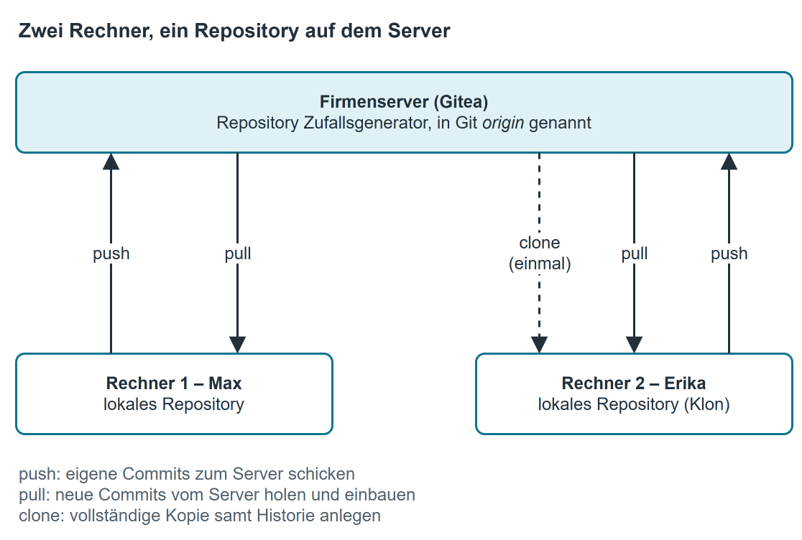
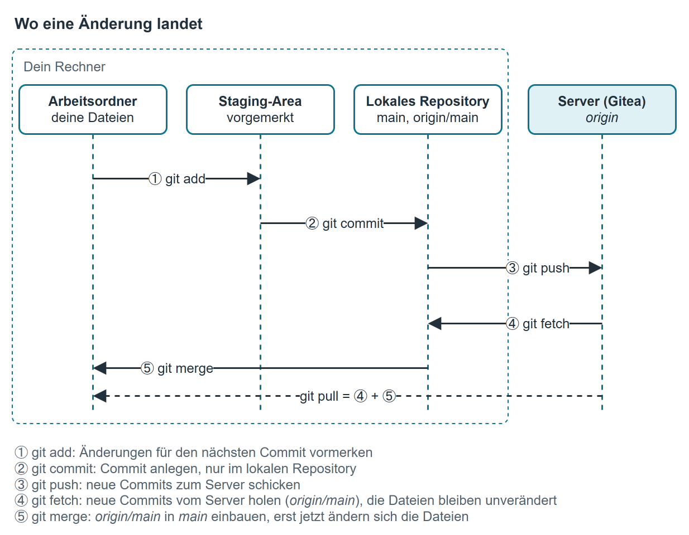
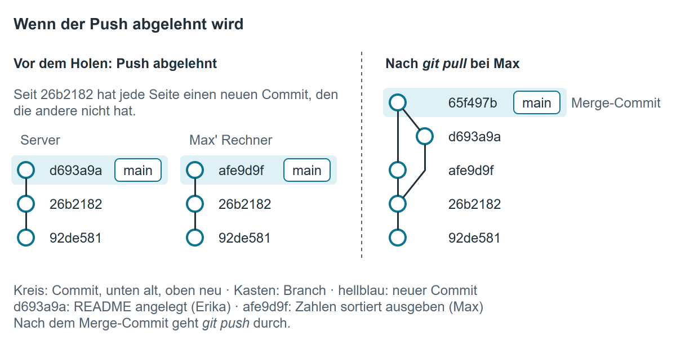
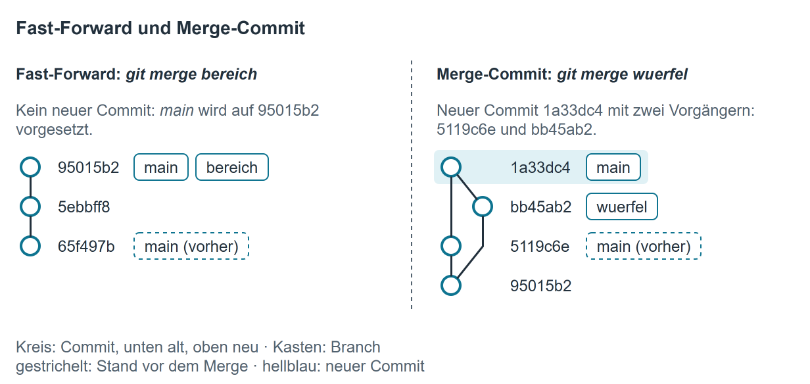

# Zu zweit an einem Repository arbeiten

Das Kapitel [Bestehendes Projekt unter Git stellen](bestehendes_projekt.md) endet damit, dass dein Projekt auf dem Firmenserver liegt. Hier geht es weiter: Eine zweite Person holt sich das Repository auf ihren Rechner, beide ändern etwas, und die Änderungen wandern über den Server von einem Rechner zum anderen.

Im Beispiel hat Max das Projekt `Zufallsgenerator` auf den Server gebracht. Erika arbeitet an einem zweiten Rechner mit.

{ .diagramm }

Die beiden Rechner tauschen dabei nie direkt etwas aus: Jeder hat ein vollständiges eigenes Repository, abgeglichen wird über den Server.

!!! info "Schreibrechte auf dem Server"
    Pushen darf nur, wer auf dem Server Schreibrechte für das Repository hat. Liegt das Repository unter dem Konto einer Person, trägt diese die andere ein: im Repository auf Gitea `Settings` → `Collaborators` → Benutzername eingeben → `Add Collaborator`. Liegt das Repository in einer Organisation, vergibt die Organisation die Rechte über ihre Teams.

## Schritt 1 – Repository auf einen zweiten Rechner holen

Erika kopiert die URL des Repositories aus Gitea (wie in [Git auf der Kommandozeile](git_cmd.md), Schritt 1) und klont es in den Ordner, in dem ihre Projekte liegen:

```
cd C:\Projekte
git clone https://bszw-git.ddns.net:3000/swopperer/Zufallsgenerator.git
```

```
Cloning into 'Zufallsgenerator'...
```

Danach folgen noch einige Zeilen, die den Fortschritt anzeigen.

`git clone` legt den Ordner `Zufallsgenerator` an und holt die **gesamte Historie** dazu, nicht nur den letzten Stand. Außerdem trägt Git den Server gleich unter dem Namen `origin` ein und verbindet den Branch `main` mit `origin/main`. Deshalb genügen später `git push` und `git pull` ohne weitere Angaben.

Alle weiteren Befehle gibst du **im Projektordner** ein:

```
cd Zufallsgenerator
git status
```

```
On branch main
Your branch is up to date with 'origin/main'.

nothing to commit, working tree clean
```

### Namen und E-Mail eintragen

Jeder Commit speichert, wer ihn angelegt hat. Git nimmt dafür Name und E-Mail aus seiner eigenen Einstellung, **nicht** aus deinem Konto auf dem Server: Die Anmeldung bei Gitea entscheidet nur, ob du pushen darfst; welcher Name in der Historie steht, entscheidet `git config`. Ist auf dem Rechner noch nichts eingetragen, verweigert Git den Commit:

```
Author identity unknown

*** Please tell me who you are.

Run

  git config --global user.email "you@example.com"
  git config --global user.name "Your Name"

to set your account's default identity.
Omit --global to set the identity only in this repository.
```

Name und E-Mail können an zwei Stellen stehen:

| Befehl | gilt für | gespeichert in |
|---|---|---|
| `git config --global user.name "Erika Musterfrau"` | alle Repositories deines Windows-Benutzerkontos | `.gitconfig` in deinem Benutzerordner |
| `git config user.name "Erika Musterfrau"` | nur dieses eine Repository | `.git\config` im Projektordner |

Ist beides gesetzt, gilt der Eintrag des Repositories. Den Befehl ohne `--global` musst du im Projektordner eingeben; außerhalb meldet Git `fatal: not in a git directory`.

Erika trägt sich nur für dieses Repository ein:

```
git config user.name "Erika Musterfrau"
git config user.email "erika.musterfrau@bszw.de"
```

Welcher Name gerade gilt und woher er kommt, zeigt:

```
git config --show-origin user.name
```

```
file:.git/config	Erika Musterfrau
```

Steht vorn `file:C:/Users/…/.gitconfig`, stammt der Name aus der globalen Einstellung.

!!! warning "Gemeinsam genutzte Schulrechner"
    Meldet ihr euch an einem Rechner mit einem **gemeinsamen** Windows-Konto an, gilt eine Einstellung mit `--global` für alle, die nach dir an diesem Konto arbeiten – ihre Commits erscheinen dann unter deinem Namen. Trage Name und E-Mail an solchen Rechnern nur für das Repository ein (ohne `--global`). `git config user.name` zeigt dir jederzeit, unter welchem Namen Git gerade committet.

    Ähnlich ist es mit der Anmeldung am Server: Windows merkt sich das Gitea-Passwort nach dem ersten Push. Wer danach am selben Windows-Konto pusht, pusht mit deinem Gitea-Konto. Den gespeicherten Eintrag entfernst du in der Windows-Anmeldeinformationsverwaltung unter *Windows-Anmeldeinformationen* (Eintrag `git:https://bszw-git.ddns.net:3000`).

## Schritt 2 – Ändern, committen, pushen

Das geht wie bei der Arbeit allein (siehe [Git auf der Kommandozeile](git_cmd.md), Schritt 3 und 4). Erika ändert `Program.cs` und schickt die Änderung zum Server:

```
git add .
git commit -m "Anzahl der Zahlen abfragen"
git push
```

```
To https://bszw-git.ddns.net:3000/swopperer/Zufallsgenerator.git
   92de581..26b2182  main -> main
```

Die letzte Zeile heißt: Der Branch `main` auf dem Server zeigte bisher auf den Commit mit der Kennung `92de581` und zeigt jetzt auf Erikas neuen Commit `26b2182`. Weil der Branch schon beim Klonen mit dem Server verbunden wurde, braucht Erika kein `-u origin main`.

Zeilen, die mit `remote:` beginnen, schreibt der Server dazu. Für den Push selbst spielen sie keine Rolle.

Wohin die Änderung bei jedem Befehl wandert, zeigt das Bild. Die Pfeile ④ und ⑤ gehören zu Schritt 3.

{ .diagramm }

## Schritt 3 – Änderungen der anderen Person holen

Max' Rechner weiß von Erikas Commit noch nichts. Auch `git status` meldet bei ihm weiterhin *Your branch is up to date with 'origin/main'* – Git vergleicht nur mit dem Stand des Servers, den es zuletzt gesehen hat.

Max holt die Änderung:

```
git pull
```

```
From https://bszw-git.ddns.net:3000/swopperer/Zufallsgenerator
   92de581..26b2182  main       -> origin/main
Updating 92de581..26b2182
Fast-forward
 Program.cs | 9 +++++++--
 1 file changed, 7 insertions(+), 2 deletions(-)
```

`git pull` erledigt zwei Dinge nacheinander:

1. **Holen** (`git fetch`): Git lädt die neuen Commits vom Server und merkt sich den Stand des Servers als `origin/main` (die ersten beiden Zeilen). Die Dateien in deinem Ordner ändern sich dabei noch nicht.
2. **Einbauen** (`git merge`): Git führt `origin/main` in deinen Branch `main` zusammen. Erst jetzt ändern sich die Dateien im Projektordner; die letzten Zeilen zeigen, welche.

Im [Bild bei Schritt 2](#schritt-2-andern-committen-pushen) sind das die Pfeile ④ und ⑤.

*Fast-forward* heißt: Max hatte seit dem letzten Abgleich nichts Eigenes committet, Git musste seinen Branch nur auf Erikas Commit vorsetzen (siehe [Fast-Forward und Merge-Commit](#fast-forward-und-merge-commit)).

Kontrolle mit der Historie:

```
git log --oneline
```

```
26b2182 (HEAD -> main, origin/main, origin/HEAD) Anzahl der Zahlen abfragen
92de581 Projekt unter Versionsverwaltung gestellt
```

Erikas Commit steht oben. `HEAD -> main` (Max' aktueller Stand) und `origin/main` (der Stand des Servers) stehen auf demselben Commit, beide Seiten sind also gleich. Wer welchen Commit angelegt hat, zeigt das Kapitel [Ein Repository lesen](repository_lesen.md).

### Nur nachsehen, ob es etwas Neues gibt

`git fetch` ist der erste Teil von `git pull` für sich allein: Es holt, baut aber nichts ein. Danach weiß `git status` Bescheid:

```
git fetch
git status
```

```
On branch main
Your branch is behind 'origin/main' by 1 commit, and can be fast-forwarded.
  (use "git pull" to update your local branch)

nothing to commit, working tree clean
```

## Wenn der Push abgelehnt wird

Max hat einen eigenen Commit angelegt („Zahlen sortiert ausgeben“). In der Zwischenzeit hat Erika eine `README.md` angelegt und gepusht. Max pusht:

```
git push
```

```
To https://bszw-git.ddns.net:3000/swopperer/Zufallsgenerator.git
 ! [rejected]        main -> main (fetch first)
error: failed to push some refs to 'https://bszw-git.ddns.net:3000/swopperer/Zufallsgenerator.git'
hint: Updates were rejected because the remote contains work that you do not
hint: have locally. This is usually caused by another repository pushing to
hint: the same ref. If you want to integrate the remote changes, use
hint: 'git pull' before pushing again.
hint: See the 'Note about fast-forwards' in 'git push --help' for details.
```

**Was die Meldung bedeutet:** Auf dem Server liegt ein Commit, den Max nicht hat (Erikas README). Würde Git Max' Stand trotzdem hochladen, wäre Erikas Commit auf dem Server verloren. Deshalb lehnt Git ab (`rejected`) und nennt die Ursache: erst holen (`fetch first`). Weder auf dem Server noch bei Max hat sich durch den Versuch etwas geändert.

{ .diagramm }

**Was hilft:** holen, dann erneut pushen. Öffnet sich beim Holen ein Editor, lies [weiter unten](#wenn-sich-beim-holen-ein-editor-offnet).

```
git pull
```

```
From https://bszw-git.ddns.net:3000/swopperer/Zufallsgenerator
   26b2182..d693a9a  main       -> origin/main
Merge made by the 'ort' strategy.
 README.md | 3 +++
 1 file changed, 3 insertions(+)
 create mode 100644 README.md
```

Diesmal gibt es auf beiden Seiten etwas Neues, ein Fast-Forward ist nicht möglich. Git legt einen **Merge-Commit** an, der beide Stände zusammenführt (`ort` ist nur der Name des Verfahrens, mit dem Git zusammenführt). Jetzt hat Max alles, was auf dem Server liegt, und der Push geht durch:

```
git push
```

```
To https://bszw-git.ddns.net:3000/swopperer/Zufallsgenerator.git
   d693a9a..65f497b  main -> main
```

Haben beide dieselben Zeilen derselben Datei geändert, kann Git die Stände nicht selbst zusammenführen und hält mit der Meldung `CONFLICT` an.

### Wenn sich beim Holen ein Editor öffnet

Für den Merge-Commit braucht Git eine Nachricht. In der Kommandozeile öffnet Git dafür einen Texteditor, in dem schon ein Vorschlag steht:

```
Merge branch 'main' of https://bszw-git.ddns.net:3000/swopperer/Zufallsgenerator
# Please enter a commit message to explain why this merge is necessary,
# especially if it merges an updated upstream into a topic branch.
#
# Lines starting with '#' will be ignored, and an empty message aborts
# the commit.
```

Git wartet, bis der Editor wieder geschlossen ist. Welcher Editor erscheint, wurde bei der Installation von Git festgelegt:

| Editor | Vorschlag übernehmen und weitermachen |
|---|---|
| Vim (der Text steht direkt im Konsolenfenster, ganz unten der Dateiname) | ++esc++ drücken, `:wq` tippen, ++enter++ drücken |
| Notepad, Notepad++ oder Visual Studio Code (eigenes Fenster) | Datei speichern und das Fenster schließen |

Zeilen mit `#` landen nicht in der Nachricht. Wer den Editor gar nicht sehen will, übernimmt den Vorschlag gleich beim Holen:

```
git pull --no-edit
```

!!! info "Meldung *Need to specify how to reconcile divergent branches*"
    Diese Meldung erscheint statt des Merge-Commits nur, wenn bei der Installation von Git keine Voreinstellung für `git pull` gewählt wurde. Git hat dann zwar geholt, aber nichts eingebaut. Mit

    ```
    git config pull.rebase false
    ```

    führt `git pull` in diesem Repository so zusammen, wie oben beschrieben. Danach `git pull` noch einmal aufrufen.

## Mit einem Branch arbeiten und zurückführen

Ein Branch ist eine eigene Entwicklungslinie. Commits auf einem Branch ändern `main` nicht, bis der Branch in `main` zurückgeführt (gemergt) wird.

### Branch anlegen und pushen

Erika legt einen Branch an und wechselt hinein:

```
git switch -c bereich
```

```
Switched to a new branch 'bereich'
```

`git checkout -b bereich` aus [Git auf der Kommandozeile](git_cmd.md) macht dasselbe. Danach committet Erika wie gewohnt. Beim ersten Push des Branches gibt sie an, wohin er gehört:

```
git push -u origin bereich
```

```
To https://bszw-git.ddns.net:3000/swopperer/Zufallsgenerator.git
 * [new branch]      bereich -> bereich
branch 'bereich' set up to track 'origin/bereich'.
```

`* [new branch]` heißt: Den Branch gab es auf dem Server bisher nicht.

### Den Branch auf dem anderen Rechner ansehen

Max lädt herunter, was es auf dem Server Neues gibt:

```
git fetch
```

```
From https://bszw-git.ddns.net:3000/swopperer/Zufallsgenerator
 * [new branch]      bereich    -> origin/bereich
```

Max' Dateien und sein Branch `main` bleiben dabei, wie sie sind. Der neue Branch ist jetzt als `origin/bereich` bekannt:

```
git branch -a
```

```
* main
  remotes/origin/HEAD -> origin/main
  remotes/origin/bereich
  remotes/origin/main
```

Zum Ansehen wechselt Max in den Branch:

```
git switch bereich
```

```
branch 'bereich' set up to track 'origin/bereich'.
Switched to a new branch 'bereich'
```

Git legt dabei auf Max' Rechner einen Branch `bereich` an, der mit `origin/bereich` verbunden ist. Die Dateien im Projektordner zeigen jetzt Erikas Stand; Max kann das Projekt in Visual Studio öffnen, bauen und ausprobieren.

Welche Commits der Branch gegenüber `main` mitbringt und welche Dateien sie ändern:

```
git log --oneline main..bereich
git diff --stat main bereich
```

```
95015b2 (HEAD -> bereich, origin/bereich) README an Bereich angepasst
5ebbff8 Untergrenze und Obergrenze abfragen
```

```
 Program.cs | 6 +++++-
 README.md  | 2 +-
 2 files changed, 6 insertions(+), 2 deletions(-)
```

Ohne `--stat` zeigt `git diff main bereich` die geänderten Zeilen selbst.

### Branch zurückführen

Zurückführen heißt: Die Commits des Branches kommen in `main`. Das kann jede der beiden Personen tun, im Beispiel Max:

```
git switch main
git pull
git merge bereich
git push
```

1. `git switch main` – Git führt immer **in** den Branch zurück, in dem du gerade bist.
2. `git pull` – bringt `main` auf den Stand des Servers. Fehlt dir dort ein Commit, würde der Push am Ende abgelehnt (siehe [oben](#wenn-der-push-abgelehnt-wird)).
3. `git merge bereich` – holt die Commits von `bereich` in `main`:

    ```
    Updating 65f497b..95015b2
    Fast-forward
     Program.cs | 6 +++++-
     README.md  | 2 +-
     2 files changed, 6 insertions(+), 2 deletions(-)
    ```

4. `git push` – erst jetzt ist das Zurückführen auch auf dem Server angekommen:

    ```
    To https://bszw-git.ddns.net:3000/swopperer/Zufallsgenerator.git
       65f497b..95015b2  main -> main
    ```

### Fast-Forward und Merge-Commit

**Fast-Forward:** Ist auf `main` seit dem Abzweigen des Branches nichts dazugekommen, setzt Git `main` einfach auf den letzten Commit des Branches vor. Es entsteht kein neuer Commit, und die Historie bleibt eine gerade Linie.

**Merge-Commit:** Sind auf `main` inzwischen andere Commits dazugekommen, legt Git einen neuen Commit mit zwei Vorgängern an, der beide Linien zusammenführt. Wie beim Holen öffnet sich dafür der Editor mit einem Vorschlag (hier `Merge branch 'wuerfel'`), und `git merge --no-edit wuerfel` übernimmt ihn ohne Editor.

```
git merge wuerfel
```

```
Merge made by the 'ort' strategy.
 Wuerfel.cs | 9 +++++++++
 1 file changed, 9 insertions(+)
 create mode 100644 Wuerfel.cs
```

{ .diagramm }

Wie beides in der Historie aussieht, zeigt der Graph in [Ein Repository lesen](repository_lesen.md#historie-als-graph-uber-alle-branches).

### Branch löschen (optional)

Nach dem Zurückführen stecken alle Commits des Branches in `main`. Ob der Branch danach bestehen bleibt oder gelöscht wird, ändert an `main` nichts.

Auf deinem Rechner:

```
git branch -d bereich
```

```
Deleted branch bereich (was 95015b2).
```

`-d` löscht einen Branch nur, wenn dabei keine Commits verloren gehen. Sonst bricht Git mit `error: the branch '…' is not fully merged` ab.

Auf dem Server:

```
git push origin --delete bereich
```

```
To https://bszw-git.ddns.net:3000/swopperer/Zufallsgenerator.git
 - [deleted]         bereich
```

In Gitea geht das auch über `Branches` und das Papierkorb-Symbol neben dem Branch.

Auf dem anderen Rechner steht `origin/bereich` danach noch in der Liste, bis Git beim Holen aufräumt:

```
git fetch --prune
```

```
From https://bszw-git.ddns.net:3000/swopperer/Zufallsgenerator
 - [deleted]         (none)     -> origin/bereich
```

Einen dort angelegten Branch `bereich` löscht die andere Person ebenfalls mit `git branch -d bereich`.

## Dasselbe in Visual Studio

Bilder zu Klonen, Commit und Push findest du in [Git in Visual Studio](git_vs.md). Die Befehle zum Holen und Pushen stehen im Menü `Git` und als Schaltflächen oben im Fenster `Git Changes` (von links: `Fetch`, `Pull`, `Push`, `Sync`).

**Klonen und Namen eintragen**

1. Startfenster `Clone a repository` oder Menü `Git` → `Clone Repository...`, URL und Zielordner eintragen, `Clone`.
2. `Git` → `Settings`: Unter `Source Control` → `Git Global Settings` stehen `User name` und `Email` für alle Repositories, unter `Git Repository Settings` dieselben Felder nur für das geöffnete Repository.

**Holen und pushen**

- `Git` → `Fetch` holt nur. Unter dem Branchnamen im Fenster `Git Changes` steht danach, wie viele Commits auf dem Server neu sind (*incoming*) und wie viele bei dir noch nicht gepusht sind (*outgoing*).
- `Git` → `Pull` holt und baut ein. Visual Studio öffnet dabei keinen Editor, den Merge-Commit legt es mit der vorgeschlagenen Nachricht an.
- `Git` → `Push` pusht. `Git` → `Sync (Pull then Push)` macht beides nacheinander.
- Liegt dein Branch hinter dem auf dem Server, pusht Visual Studio nicht, sondern weist darauf hin und bietet `Pull then Push` an – das ist dasselbe wie `git pull` und danach `git push`.

**Branch ansehen und wechseln**

1. `Git` → `Fetch`, dann `Git` → `Manage Branches` (öffnet das Fenster `Git Repository`).
2. Links unter `remotes` → `origin` stehen die Branches des Servers. Ein Klick zeigt die Historie des Branches, ohne ihn zu wechseln.
3. Rechtsklick auf `bereich` → `Checkout` legt den Branch auf deinem Rechner an und wechselt hinein.

Den aktuellen Branch wechselst du auch über den Branchnamen unten rechts in der Statusleiste.

**Branch zurückführen**

1. `Git` → `Manage Branches`.
2. Rechtsklick auf `main` → `Checkout`, danach `Pull`.
3. Rechtsklick auf `bereich` → `Merge 'bereich' into 'main'`.
4. `Push`.

**Branch löschen:** in `Manage Branches` Rechtsklick auf den Branch → `Delete`. Auf dem Server löschst du ihn in Gitea (siehe oben).

## Kontrolle

| Prüfung | So geht sie |
|---|---|
| Unter welchem Namen committe ich? | `git config user.name` zeigt den Namen für neue Commits; `git log` zeigt ihn bei jedem Commit unter *Author*. |
| Gibt es auf dem Server etwas Neues? | `git fetch`, dann `git status`: *Your branch is behind 'origin/main'* heißt, es gibt etwas zu holen. |
| Ist alles committet? | `git status` meldet *nothing to commit, working tree clean*. |
| Ist alles auf dem Server? | `git fetch`, dann `git status`: *Your branch is up to date with 'origin/main'*. |
| Haben beide Rechner denselben Stand? | `git log --oneline -1` zeigt auf beiden Rechnern dieselbe Kennung. |
| Ist der Branch auf dem Server? | `git branch -a` zeigt `remotes/origin/bereich`; in Gitea steht er unter `Branches`. |
| Ist der Branch zurückgeführt? | `git branch -a --no-merged main` führt ihn nicht mehr auf (siehe [Ein Repository lesen](repository_lesen.md#nicht-zuruckgefuhrte-branches-finden)). |
